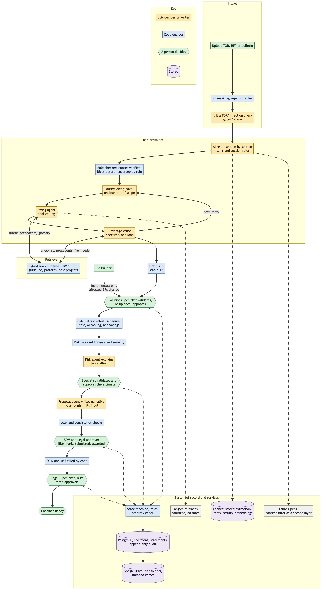

# AI Deal-to-Delivery Advisor

**Synthetic data only. Decision support: AI reads and drafts, code verifies, stores and calculates, people approve. Internal pricing is never client-facing.**

A capstone project: a presales workflow that takes a client's Terms of Reference or RFP through to a Contract-Ready package. It runs on Azure Container Apps, behind a password.

## Problem and user

The users are presales teams at a software company: the BDM who owns the deal, the Solutions Specialist who validates scope and effort, and the Legal or Management reviewer.

Turning a TOR into a defensible estimate takes days, and business analysts are the bottleneck. Claims about AI productivity go into estimates unvalidated. Proposals are assembled by hand, so internal figures can leak into client documents. What's said in a TOR, what's priced and what's promised can drift apart with no record of why.

## What it does

BDM Intake → AI Draft BRD → Specialist Validation → Estimates and Timeline → Validation → Proposal → Award → SOW and MSA → Three Approvals → **Contract-Ready**.

- **Extraction is AI-first with a rule checker.** The LLM reads each section, code checks every quote against the document, and rules decide what one requirement is. This was chosen by measuring three approaches ([extraction_approaches.md](docs/evaluation/extraction_approaches.md)).
- **PostgreSQL is the system of record.** Documents are generated from it. Each stage change is gated by role and written to an append-only audit trail.
- **Versions follow a QMS rule:** minor is a draft or controlled update, major is an approved baseline. A change never regenerates the BRD: only what it touches changes, and a stability check blocks anything else.
- **Bid bulletins and re-uploads are incremental,** with a diff shown first. Removed items are Withdrawn, never deleted.
- **Estimates come from calculators, in code,** for AI-Augmented (B) and AI-First (C) delivery, including AI tooling cost and net savings against a pre-AI baseline.
- **Publishing is one-way to Google Drive,** in flat folders per opportunity. If Drive is down, documents wait as "publish pending" and the work continues.
- **The MSA template is read at runtime** from a private Drive folder, never the repo or image. Code fills it, and its wording is never stored, logged or sent to the LLM.

It does not replace the Specialist's judgment, approve anything by itself, or produce validated productivity figures. AI productivity factors are assumptions.

## Architecture



The diagram's source is [docs/architecture.mmd](docs/architecture.mmd), and the requirements graph is in [docs/graph.md](docs/graph.md).

## Agentic capabilities

These are tool-calling agents with consistent behaviour. They choose their own tools by function calling, and in practice they make much the same choices from deal to deal. [agent_behaviour.md](docs/evaluation/agent_behaviour.md) records what each does, checked against traces.

| Step | What it does | Who decides |
|---|---|---|
| Intake guard | Masks PII, removes injection lines, rejects non-TORs | Code, plus `gpt-4.1-nano` |
| AI read and rule checker | Lists items and section roles; verifies quotes; sets BR structure and coverage | LLM reads, code verifies |
| Router | `clear`, `novel`, `unclear` or `out_of_scope`, per feature | `gpt-4.1-mini`, with code overrides |
| Sizing agent | Tool-calling agent: rubric, precedents and glossary, then a size. Nearly always calls the rubric and precedents | LLM, with cached answers reused |
| Coverage critic | A separate step after sizing, against the guideline's checklist. Its proposals return through the router once | LLM with no tools. Code supplies its inputs and adds checklist rules |
| Risk agent | Tool-calling agent. **Code sets the triggers and severity, and the agent explains them** | Code decides, LLM explains |
| Proposal agent | Writes narrative from client-safe facts, with no amounts in its input | LLM, then leak and consistency checks |
| People | Every approval, in every gate | People |

## Advanced RAG

Hybrid retrieval, dense plus BM25 with reciprocal rank fusion, over a guideline, sizing rubrics, patterns, a glossary and six anonymized past projects, with metadata filters and citations. **On an unfiltered golden set, dense scored higher than hybrid on 3 of 4 metrics.** Production stays hybrid, because the agents' own searches are filtered and that case was not measured ([rag_results.md](docs/evaluation/rag_results.md)).

## Evaluation

Dev and held-out sets are reported separately. The full index is in [docs/evaluation/README.md](docs/evaluation/README.md).

| Measure | Dev | Held-out, final (3 TORs) |
|---|---:|---:|
| Feature recall after critic review | 100% on 8 TORs | 100% |
| Planted flaws caught | 14/14 | 14/19 |
| Expected risks found | 8/8 (HRIS) | 15/21 |
| Sizes within one tier | 60/60 | 51/57 |
| Runs completed at baseline | | 2 of 3 |

| Other evidence | Result |
|---|---|
| RAGAS, 31 reviewed questions | Faithfulness 0.91 and context recall 0.89 on hybrid, the production setting; dense 0.94 and 0.94 |
| Scenarios, with designed failures | 34 of 34 |
| Suitability prompts, 30 human labels | V3 0.80, V1 0.17; 0.63 on what users see in the sample |
| Caching | A repeat run: about USD 0.15 and 195 s down to 0 and 2 s |
| Debugged failures | [Extraction, through to the design change, and the merge pass](docs/evaluation/debugged_failure.md) |
| Iterations | [I-01 to I-21](docs/evaluation/iterations.md), each with before and after |

## Guardrails, caching and cost controls

- **Guardrails:** 20, each with its proof, in [guardrails.md](docs/evaluation/guardrails.md): injection, PII, non-TOR rejection, leak blocking, approval gates, consent, a price floor, roles, audit, the stability check and more. It also records the gap the held-out set found in the injection guard.
- **Caching:** answers are stored per section, and items and whole-run results are reused, with the invalidation policy in [caching.md](docs/evaluation/caching.md).
- **Cost controls:** per-run, daily and total caps (`MAX_RUN_USD`, `MAX_DAILY_USD`, `MAX_TOTAL_USD`).
- **Tracing:** LangSmith, off unless `LANGSMITH_TRACING=true`, with one sanitizer on every payload ([tracing.md](docs/evaluation/tracing.md)). The public app traces with this sanitizer: inputs and outputs are not fully hidden.

## How it was built

The work ran in stages, each with its own plan and stop points. Those plan files are working documents and are not in this repository.

| Stage | What it added |
|---|---|
| v1 | A LangGraph agent from TOR to sized backlog, with hybrid retrieval, calculators and guardrails |
| v2 | Activity-level estimation for AI-Augmented and AI-First delivery, costing, risks and a proposal |
| v3 | The management workflow: PostgreSQL as the record, roles, versions, incremental changes, Drive, SOW and MSA |
| Phase 5 | Tracing, the evaluation above and everything it changed, logged as [iterations](docs/evaluation/iterations.md). Features were frozen except for fixes found by evaluation |

## Limitations

- **Synthetic evaluation data.** Keys are by one author, the held-out set is small, and the judge is a single model.
- **Known faults at the final evaluation:** a contact name written mid-sentence is not masked yet, so it reaches the LLM and, with tracing on, LangSmith. A held-out bulletin's changed value did not land, though the same fault is fixed on a dev bulletin. Some conflicts and vague requirements are missed.
- **Injection is not fully solved.** Rule patterns miss new phrasing. Azure's content filter is a second layer, and a line nothing catches reaches the LLM as data.
- **Roles are self-declared.** Real sign-in is production scope, and that includes the Admin role behind the purge.
- **Clause flags are in-app only,** not written into the MSA.
- **Shared PostgreSQL server,** with a dedicated database and roles.
- **Drive sign-in is tied to one Google account,** and it expires about every 7 days while the consent screen stays in Testing.
- **Tables are detected when ruled or laid out on fixed columns.** Others reach the LLM as text.
- **AI productivity, tooling prices and usage are illustrative assumptions.** They are not validated by a pilot.
- **Rates are illustrative unless an admin uploads others for a session,** and rate values are never stored.

## Assumptions

- **All hours, productivity factors, foundation hours and team templates in `config/` are practitioner-validated
  assumptions, not benchmarks.** Size-tier hours are calibrated on two internal pre-AI projects (one per complexity
  class: two data points, not validated out-of-sample). The teams were senior-led, so an average-seniority team may
  need more hours. Production would replace these values with the company's real estimation guideline.
  See [docs/calibration.md](docs/calibration.md).
- AI productivity profiles, delivery practices and tooling prices are starting assumptions to validate on real AI-enabled projects.
- Default architecture: cloud-deployed microservices.

## Run locally

```bash
python3.11 -m venv .venv && source .venv/bin/activate
pip install -r requirements.txt
cp .env.example .env        # fill in values (never commit .env)
python scripts/build_index.py              # embeds the corpus once (cached by content hash)
streamlit run app/streamlit_app.py         # http://localhost:8501
pytest -q                                  # needs Docker for PostgreSQL; no Azure calls
python eval/task_eval.py dev run1          # task evaluation on the dev set
python scripts/calibrate.py --doc          # regenerate docs/calibration.md
```

Docker:

```bash
docker build -t deal-advisor:local .
docker run --rm --env-file .env -p 8501:8501 deal-advisor:local
```

### Environment variables

| Variable | Purpose |
|---|---|
| `AZURE_OPENAI_ENDPOINT`, `AZURE_OPENAI_API_KEY`, `AZURE_OPENAI_API_VERSION` | Azure OpenAI connection (key only via env / container secret) |
| `AZURE_OPENAI_MAIN_DEPLOYMENT` | gpt-4.1-mini: extraction, router, sizing agent, critic |
| `AZURE_OPENAI_LIGHT_DEPLOYMENT` | gpt-4.1-nano: intake classifier and injection check (falls back to MAIN) |
| `AZURE_OPENAI_EMBED_DEPLOYMENT` | text-embedding-3-small: corpus and dedup embeddings |
| `APP_PASSWORD` | Shared UI password (constant-time compare) |
| `LANGSMITH_TRACING` | `true` turns tracing on; anything else leaves it off |
| `LANGSMITH_API_KEY`, `LANGSMITH_PROJECT`, `LANGSMITH_ENDPOINT` | LangSmith key, project (default `deal-advisor-poc`), and an optional other endpoint |
| `TRACE_DOCUMENT_SET` | Label on the traces of a run: `dev`, `test` or `app` (default) |
| `MAX_TOR_PAGES` (60), `MAX_FEATURES` (80) | Caps |
| `DATABASE_URL`, `DATABASE_URL_OWNER` | PostgreSQL: runtime role, and the migrations role (local only, never in the container) |
| `GDRIVE_CLIENT_ID`, `GDRIVE_CLIENT_SECRET`, `GDRIVE_REFRESH_TOKEN` | Google Drive publishing (written by `scripts/drive_auth.py`) |

### Database

The app needs `DATABASE_URL`. Set up once with `infra/db_setup.sql` (its header has the commands), migrate with `alembic upgrade head` (uses `DATABASE_URL_OWNER`), and check with `infra/db_verify.sql`. The database tests in `pytest` start their own throwaway PostgreSQL in Docker, never the real server, and are skipped without Docker. Tests never publish to the real Drive.

`scripts/smoke_v3.py <url> <password>` runs the plan's smoke test in a real headless browser, through Contract-Ready. It needs Playwright and Chrome, which are deliberately not in `requirements.txt`.

### Google Drive sign-in

While the OAuth consent screen is in Testing status, Google expires the sign-in after about 7 days. The app then shows "Drive authorization expired — re-run sign-in", marks publishes as pending and keeps working. To renew it, run `python scripts/drive_auth.py`, approve in the browser, then `python scripts/drive_check.py` to verify. For a deployed app, also update the `gdrive-refresh-token` container secret, then press **Retry publish** on the opportunity.

## Operations

### Drive folders

Each opportunity has flat folders under the configured root: `inputs/`, `BRD/`, `estimate/`, `proposal/` and `contracts/`. There are no `internal/` subfolders. `proposal/` holds both copy types, drafts and approved: `PROPOSAL-<Code>-R1-v<x.y>-CLIENT.docx` and `-INTERNAL.docx`. Internal copies carry "INTERNAL — NOT FOR CLIENT" on every page. `estimate/` holds `-INTERNAL` summaries stamped "INTERNAL — CONTAINS PRICING".

**Share individual client files, never folders.** A shared `proposal/` folder would expose the internal copy, and a shared `estimate/` folder the pricing.

### Delete test data

An Admin can delete an opportunity completely from the opportunity list by typing its code: database rows including audit entries, the Drive folder (permanently), cached files and any LangSmith traces. HRIS and HRIS-04 are protected in `config/admin.yaml`. See [guardrails](docs/evaluation/guardrails.md).

### Renew the Google Drive sign-in

The OAuth consent screen stays in Testing, so Google ends the sign-in after about 7 days. When it has ended, publishing shows "publish pending" and MSA generation shows "MSA template not available". Nothing already saved is lost. To renew:

1. Sign in again. This opens a browser and writes the new token to `.env` without printing it:

   ```bash
   python scripts/drive_auth.py
   ```

2. Update the container secret and restart the revision, so the running app reads it:

   ```bash
   set -a; . ./.env; set +a
   az containerapp secret set --subscription <subscription-id> -g <resource-group> -n <app-name> \
     --secrets gdrive-refresh-token="$GDRIVE_REFRESH_TOKEN"
   REVISION=$(az containerapp show --subscription <subscription-id> -g <resource-group> -n <app-name> --query properties.latestRevisionName -o tsv)
   az containerapp revision restart --subscription <subscription-id> -g <resource-group> -n <app-name> --revision "$REVISION"
   ```

3. Verify: on the public URL, publish one version, or use **Retry publish** on one that is pending, and confirm the file appears in the Drive folder.

## Deploy and teardown (Azure Container Apps)

Read-only pre-flight checks, then one validated Bicep deployment (`infra/main.bicep`) into one new resource group, then an image push. Teardown removes every hosting resource in one step
and leaves the Azure OpenAI resource untouched:

```bash
az group delete -n <resource-group> --subscription <HOST_SUB> --yes --no-wait
```

## Next steps

- Brief-only intake for title-only government requests.
- Name masking for names inside sentences, then the other known faults above.
- Admin delete: show progress. Today it shows only "working, please wait" for over a minute, then the report.
- A pilot to validate AI productivity, and more calibration projects.
- Real sign-in and a managed identity, in place of self-declared roles.
- A real rate store, and live market research for the estimate.
- A measured decision on retrieval, on the agents' filtered searches.
- Fine-tuning was not attempted: the corpus is small, the labels are few, and the failures found were structural rather than wording.
