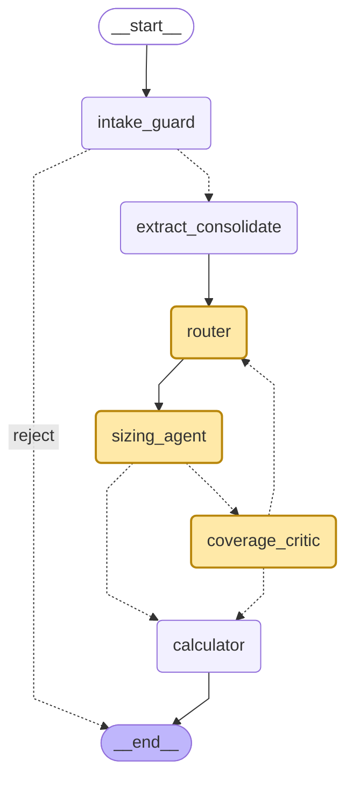

# Agent graph

Generated with `graph.get_graph().draw_mermaid()`. Agent nodes (LLM decisions) are highlighted: router, sizing_agent (a tool-calling agent with consistent behaviour: it calls the rubric and precedents for nearly every feature), coverage_critic (no tools: code supplies its checklist and precedents). See [agent_behaviour.md](evaluation/agent_behaviour.md). Dotted arrows are conditional edges.

